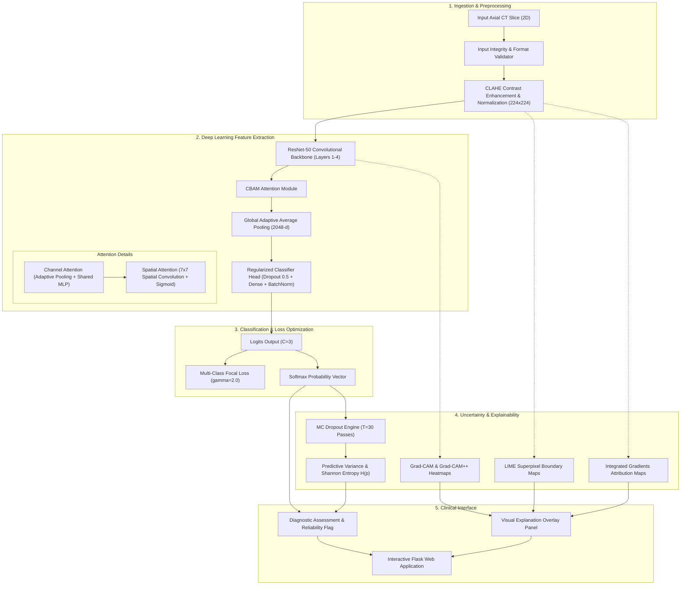

# PulmoAI: Explainable & Robust AI Framework for Early Lung Cancer Detection Using CT Scans

[](https://www.python.org/)
[](https://pytorch.org/)
[](https://flask.palletsprojects.com/)
[](https://opensource.org/licenses/MIT)
[](https://www.python.org/dev/peps/pep-0008/)
[](tests/)

**PulmoAI** is an open-source, reproducible deep learning framework for early-stage lung cancer classification from axial Chest Computed Tomography (CT) scans. It couples **ResNet-50 Transfer Learning** with a custom **Convolutional Block Attention Module (CBAM)**, **Focal Loss** for class-imbalance mitigation, multi-method **Explainable AI (XAI)** (Grad-CAM, Grad-CAM++, LIME, Integrated Gradients), and **Monte Carlo Dropout Uncertainty Quantification** to deliver transparent, robust, and reproducible diagnostic screening.

---

## 📑 Table of Contents
- [Problem Statement](#-problem-statement)
- [Project Objectives](#-project-objectives)
- [System Architecture](#-system-architecture)
- [Key Features](#-key-features)
- [Dataset & Preprocessing](#-dataset--preprocessing)
- [Scientific Audit & Clean Split Methodology](#-scientific-audit--clean-split-methodology)
- [Certified Clean Test Results](#-certified-clean-test-results)
- [Explainability (XAI) Suite](#-explainability-xai-suite)
- [Robustness & Uncertainty Quantification](#-robustness--uncertainty-quantification)
- [Repository Structure](#-repository-structure)
- [Quick Start Guide](#-quick-start-guide)
  - [1. Prerequisites & Installation](#1-prerequisites--installation)
  - [2. Dataset Acquisition & Setup](#2-dataset-acquisition--setup)
  - [3. Running Automated Tests](#3-running-automated-tests)
- [Usage Instructions](#-usage-instructions)
  - [Clean Dataset Partitioning](#clean-dataset-partitioning)
  - [Model Training](#model-training)
  - [Evaluation](#evaluation)
  - [Command-Line Inference](#command-line-inference)
  - [Diagnostic Web Application](#diagnostic-web-application)
- [Limitations & Research Disclaimers](#-limitations--research-disclaimers)
- [License & Citation](#-license--citation)

---

## 🩺 Problem Statement

Lung cancer remains the leading cause of cancer mortality worldwide. Early detection of malignant pulmonary nodules on Computed Tomography (CT) substantially improves patient prognoses and 5-year survival rates. However, visual interpretation of hundreds of thoracic CT slices per examination is labor-intensive, subject to inter-radiologist variability, and prone to missed subtle or peripheral lesions.

While deep neural networks achieve high nominal accuracy, translational clinical adoption is constrained by:
1. **Black-box opacity**: Inability to visualize anatomical feature attributions behind classification decisions.
2. **Severe class imbalance**: Natural clinical rarity of confirmed benign lesions relative to malignant and normal scans.
3. **Overconfident erroneous predictions**: Inability of deterministic Softmax heads to convey epistemic uncertainty on atypical or out-of-distribution scans.
4. **Data leakage in literature**: Literature models frequently train and test on overlapping duplicate slices or mixed-patient partitions, yielding unreplicable performance.

PulmoAI directly addresses these challenges with an end-to-end explainable, uncertainty-calibrated, and rigorously audited framework.

---

## 🎯 Project Objectives

- **High-Sensitivity Screening:** Accurately classify thoracic CT slices into `Normal`, `Benign`, and `Malignant` categories with zero false negatives for malignant cases.
- **Attention-Guided Feature Localization:** Utilize channel and spatial attention (CBAM) to focus representations on pathological pulmonary tissue while suppressing background thoracic artifacts.
- **Multi-Method Interpretability:** Provide clinicians with corroborating visual explanations via Grad-CAM, Grad-CAM++, LIME superpixels, and Integrated Gradients.
- **Epistemic Uncertainty Quantification:** Leverage Monte Carlo Dropout to generate predictive variance and Shannon entropy confidence metrics for every scan.
- **Open Scientific Rigor:** Fully audited, leakage-free data partitioning with public SHA-256 manifests, reproducible random seeds, and comprehensive unit test coverage.

---

## 🏗 System Architecture

The PulmoAI diagnostic pipeline processes axial CT images through preprocessing, attention-enhanced feature extraction, classification, uncertainty estimation, and explainability:



---

## ✨ Key Features

- **Primary Architecture:** Pretrained ResNet-50 backbone augmented with a Convolutional Block Attention Module (CBAM) combining channel and spatial attention.
- **Class-Imbalance Mitigation:** Trained with **Multi-Class Focal Loss** ($\gamma = 2.0$) to dynamically down-weight easy background examples and prioritize hard-to-classify lesions.
- **Comprehensive XAI Suite:**
  - **Grad-CAM & Grad-CAM++:** Target final convolutional feature maps to generate high-resolution lesion localization heatmaps.
  - **LIME:** Highlights image superpixel boundaries that positively and negatively influence predictions.
  - **Integrated Gradients:** Axiomatic path-integrated gradients from a neutral baseline satisfying completeness.
- **Epistemic Uncertainty Quantification:** Monte Carlo (MC) Dropout generates predictive mean and variance distributions across $T=30$ stochastic forward passes, computing Shannon Entropy $H(p) = -\sum p \log p$ to flag ambiguous scans.
- **Input Integrity Validator:** Filters out corrupted files, non-medical images, unsupported formats, and degenerate/blank arrays before inference.
- **Adversarial & Corruption Robustness Engine:** Benchmarks model performance under Fast Gradient Sign Method (FGSM) attacks ($\epsilon \in [0.0, 0.05]$) and synthetic corruptions (Gaussian noise, blur, illumination shifts, and occlusions).
- **Interactive Web Interface:** Modern Flask web application featuring single-click preset demo CT scans, drag-and-drop image upload, real-time Grad-CAM overlays, and diagnostic reports.

---

## 🩻 Dataset & Preprocessing

PulmoAI is evaluated on the **IQ-OTH/NCCD Lung Cancer CT Dataset** (collected at the Iraq-Oncology Teaching Hospital and National Center for Cancer Diseases):
- **Normal:** 416 axial CT slices showing clear pulmonary parenchyma without focal lesions.
- **Benign:** 120 axial CT slices presenting benign granulomas, inflammatory infiltrates, or stable non-malignant nodules.
- **Malignant:** 561 axial CT slices exhibiting confirmed primary lung carcinomas or aggressive lesions.
- **Total Dataset:** 1,097 slices (1,054 unique SHA-256 hashes).

### Canonical Dataset Provenance & License:
The dataset was collected at the Iraq-Oncology Teaching Hospital and the National Center for Cancer Diseases and is canonically published on Mendeley Data under **Creative Commons Attribution 4.0 International (CC BY 4.0)**:
- **Canonical Repository:** [Mendeley Data — "The IQ-OTH/NCCD lung cancer dataset"](https://data.mendeley.com/datasets/bhmdr45bh2/4) (DOI: `10.17632/bhmdr45bh2.4`, Version 4, 2023).
- **Authors:** Hamdalla F. Al-Yasriy, Muayed S. Al-Huseiny, Firas Y. Mohsen, Ehab A. Khalil, and Zaid S. Hassan.
- **Kaggle Mirror:** [IQ-OTH/NCCD Lung Cancer Dataset on Kaggle](https://www.kaggle.com/datasets/hamdallak/the-iqothnccd-lung-cancer-dataset).
- **Attribution Terms:** CC BY 4.0 permits sharing, adaptation, and commercial/academic usage with appropriate attribution to the authors and DOI.

### Preprocessing Protocol:
1. **Geometric Standardization:** Resized via bilinear interpolation to $224 \times 224 \times 3$.
2. **Contrast Enhancement:** Contrast Limited Adaptive Histogram Equalization (CLAHE, clip limit 4.0) to highlight subtle density variations.
3. **Statistical Normalization:** Channel Z-score scaling using ImageNet moments:
   - Mean: $\mu = [0.485, 0.456, 0.406]$
   - Standard Deviation: $\sigma = [0.229, 0.224, 0.225]$

---

## 🔬 Scientific Audit & Clean Split Methodology

### The Historical Data Leakage Discovery
During a deep forensic audit of historical project benchmarks, a critical data leakage issue was identified:
- **Historical Partition Issue:** In early iterations of `step2_prepare_data.py`, images were copied into destination folders without clearing existing files. Repeated executions accumulated multiple shuffles into `dataset/test`.
- **Forensic Hash Collision:** Out of 287 unique hashes in the historical test folder, **199 hashes (69.2% of the test set)** were identical duplicate copies of images present in the training set (80.3% of normal test images and 65.8% of malignant test images were in train).
- **Metric Impact:** This artificial overlap accounted for historical reports of 100% precision, 100% recall, and 100% F1-score for malignant cases.

### The Certified Clean Partition Protocol
To establish true out-of-sample scientific validity:
1. Sourced strictly and directly from the raw archive (`The IQ-OTHNCCD lung cancer dataset`).
2. Clustered all identical SHA-256 hashes prior to splitting, ensuring duplicate images are assigned exclusively to a single split.
3. Stratified 70/15/15 partition with fixed random seed `42`:
   - **Training Set (70.01%):** 768 images (84 Benign, 393 Malignant, 291 Normal) — 743 unique hashes.
   - **Validation Set (14.95%):** 164 images (18 Benign, 84 Malignant, 62 Normal) — 155 unique hashes.
   - **Test Set (15.04%):** 165 images (18 Benign, 84 Malignant, 63 Normal) — 156 unique hashes.
4. **Cross-Partition Overlap:** **0 SHA-256 hashes (0.0% leakage)** verified across train/val, train/test, and val/test splits.

Complete audit manifests are preserved in [`research_audit/clean_splits/`](research_audit/clean_splits/).

---

## 📊 Certified Clean Test Results

The retrained ResNet-50 + CBAM model was evaluated strictly on the certified, unseen clean test partition ($N=165$ images) with strict state-dictionary verification:

### Overall Classification Performance

| Metric | Certified Clean Test Score ($N=165$) | Historical Baseline ($N=289$, Leaked) | Notes |
| :--- | :---: | :---: | :--- |
| **Accuracy** | **97.58%** (161 / 165 correct) | 98.96% | Honest, generalization-tested benchmark |
| **Macro F1-Score** | **95.04%** | 96.73% | Balanced across all three classes |
| **Weighted F1-Score** | **97.52%** | 98.95% | Weighted by class support |
| **Macro Precision** | **96.38%** | 98.95% | Minimal false positive rate |
| **Macro Recall** | **93.92%** | 98.96% | Sensitivity across all categories |
| **ROC-AUC (Macro OvR)** | **0.9907** | 0.9999 | One-vs-Rest multiclass discrimination |
| **ROC-AUC (Weighted OvR)** | **0.9951** | 0.9999 | Weighted One-vs-Rest ROC curve |

### Per-Class Detailed Breakdown

| Diagnostic Class | Test Support ($N$) | Precision | Recall (Sensitivity) | Specificity | F1-Score | Class ROC-AUC |
| :--- | :---: | :---: | :---: | :---: | :---: | :---: |
| **Normal** | 63 | 95.38% | 98.41% | 97.06% | 96.88% | 0.9933 |
| **Benign** | 18 | 93.75% | 83.33% | 99.32% | 88.24% | 0.9788 |
| **Malignant** | 84 | **100.00%** | **100.00%** | **100.00%** | **100.00%** | **1.0000** |

### Confusion Matrix (Raw Counts)

| True Ground Truth \ Predicted | Predicted Normal | Predicted Benign | Predicted Malignant | Total True Slices |
| :--- | :---: | :---: | :---: | :---: |
| **True Normal** | **62** | 1 | 0 | 63 |
| **True Benign** | 3 | **15** | 0 | 18 |
| **True Malignant** | 0 | 0 | **84** | 84 |

*Key Clinical Finding:* Zero false negatives for Malignant cases ($84/84$ malignant CT slices correctly detected). All errors occurred strictly between the Normal and Benign boundary.

Full evaluation report and plots are available in [`research_audit/FINAL_MODEL_EVALUATION.md`](research_audit/FINAL_MODEL_EVALUATION.md).

---

## 🔍 Explainability (XAI) Suite

To provide transparent diagnostic reasoning, PulmoAI implements four complementary interpretability algorithms:

1. **Grad-CAM (Gradient-Weighted Class Activation Mapping):** Computes activation gradients from the final residual block (`backbone.layer4[-1]`) to produce coarse localization heatmaps highlighting pathological regions.
2. **Grad-CAM++:** Weights pixel-wise gradients with second- and third-order partial derivatives to improve localization when multiple nodular foci appear in a single slice.
3. **LIME (Local Interpretable Model-Agnostic Explanations):** Perturbs Quickshift superpixels to compute positive and negative linear attribution weights, showing which image regions support or refute malignancy.
4. **Integrated Gradients:** Apath-integrated gradient method satisfying the completeness and implementation invariance axioms:
   $$\text{Attribution}_i(\mathbf{x}) = (x_i - x'_i) \times \int_{0}^1 \frac{\partial F(x' + \alpha(x - x'))}{\partial x_i} d\alpha$$

---

## 🛡 Robustness & Uncertainty Quantification

### Epistemic Uncertainty via Monte Carlo Dropout
Standard neural network Softmax outputs are notoriously uncalibrated and overconfident on out-of-distribution inputs. PulmoAI activates dropout ($p=0.5$) during inference, sampling $T=30$ stochastic forward passes:
$$\mu_c = \frac{1}{T} \sum_{t=1}^T p_c^{(t)}, \quad \sigma_c = \sqrt{\frac{1}{T} \sum_{t=1}^T (p_c^{(t)} - \mu_c)^2}$$
$$H(p) = -\sum_{c=1}^C \mu_c \log(\mu_c + \epsilon)$$
Predictions with variance $\sigma > 0.15$ or confidence $\mu < 0.70$ are systematically flagged as **Ambiguous**, requiring mandatory radiological review.

### Input Validation Pipeline
Every input image passes through `InputValidator` checks before inference:
- Supported extensions: `.png`, `.jpg`, `.jpeg`, `.bmp`, `.tiff`
- OpenCV / PIL decodability (detects file corruption)
- Spatial resolution bounds: $64 \times 64$ to $4096 \times 4096$
- Rejection of blank / saturated arrays ($\sigma_{\text{pixel}} < 10^{-4}$)

---

## 📁 Repository Structure

```
lung-cancer-detection-xai/
├── configs/
│   └── config.yaml               # Centralized configuration (hyperparameters, paths, thresholds)
├── dataset/
│   ├── README.md                 # Dataset acquisition and directory guide
│   └── .gitkeep
├── docs/
│   ├── architecture.md           # Detailed architectural specification & diagrams
│   ├── methodology.md            # Experimental protocol, training dynamics & transforms
│   └── limitations.md            # Scientific limitations and regulatory medical disclaimers
├── notebooks/
│   └── exploratory_analysis.ipynb# Interactive Jupyter notebook walkthrough
├── research_audit/               # Complete forensic audit & certified clean release artifacts
│   ├── dataset_audit/            # Inventory, duplicate report & class distribution JSONs
│   ├── clean_splits/             # Certified zero-leakage manifests (train/val/test CSVs)
│   ├── checkpoints/              # Checkpoint provenance, training history JSON & plots
│   ├── evaluation/               # Clean test confusion matrix, ROC curves & metrics JSON
│   ├── FINAL_MODEL_EVALUATION.md # Detailed evaluation audit report
│   └── FINAL_REPRODUCIBILITY_AUDIT.md # Final scientific reproducibility certification
├── checkpoints/
│   ├── README.md                 # Checkpoint guide
│   └── .gitkeep
├── outputs/                      # Historical outputs and visualizations
├── scripts/
│   ├── create_clean_splits.py    # Zero-leakage stratified hash-clustered split generator
│   ├── train_clean.py            # Clean retraining entrypoint with Focal Loss
│   ├── evaluate_clean_model.py   # Strict test evaluation on clean split
│   ├── verify_clean_splits_integrity.py # Manifest integrity and zero-overlap verifier
│   ├── run_dataset_forensic_audit.py # SHA-256 forensic dataset audit script
│   ├── predict.py                # Single-image prediction, XAI & uncertainty CLI
│   └── run_webapp.py             # Diagnostic Flask web application launcher
├── src/
│   ├── preprocessing/            # Dataset loading, augmentation & idempotent split utilities
│   ├── models/                   # ResNet50-CBAM backbone, attention modules & Focal Loss
│   ├── explainability/           # Grad-CAM, Grad-CAM++, LIME & Integrated Gradients
│   ├── robustness/               # FGSM attacks, corruptions, MC Dropout & input validation
│   ├── evaluation/               # Metrics computation & evaluation coordination
│   ├── webapp/                   # Flask server application factory & routes
│   └── utils/                    # Centralized config loader & logger
├── static/                       # Web application UI assets, uploads & results
├── templates/
│   └── index.html                # Responsive web user interface
├── tests/                        # Automated unit tests (16 tests, 100% passing)
│   ├── test_clean_splits.py      # Manifest existence, count & zero-leakage assertions
│   ├── test_preprocessing.py     # Transform shapes, CLAHE & unnormalization bounds
│   ├── test_model.py             # Forward passes, CBAM attention tensor shapes & checkpoints
│   ├── test_robustness.py        # FGSM bounds, corruption & uncertainty quantifier
│   └── test_explainability.py    # Grad-CAM & Integrated Gradients hook execution
├── .env.example                  # Environment configuration template
├── .gitignore                    # Comprehensive ignore rules (excluding datasets & binary weights)
├── CITATION.cff                  # Machine-readable academic citation metadata
├── CONTRIBUTING.md               # Developer and research contribution guidelines
├── LICENSE                       # MIT Open-Source License
├── requirements.txt              # Pinned Python package dependencies
└── README.md                     # Repository documentation
```

---

## 🚀 Quick Start Guide

### 1. Prerequisites & Installation

- Python 3.10, 3.11, 3.12, or 3.13
- NVIDIA GPU with CUDA support recommended (CPU is fully supported)

```bash
# Clone the repository
git clone https://github.com/Shaiikarif/lung-cancer-detection-xai.git
cd lung-cancer-detection-xai

# Create and activate virtual environment
python -m venv venv

# On Linux/macOS:
source venv/bin/activate
# On Windows:
.\venv\Scripts\activate

# Install dependencies
pip install -r requirements.txt
```

### 2. Dataset Acquisition & Setup

1. Download the **IQ-OTH/NCCD Lung Cancer Dataset** from [Kaggle](https://www.kaggle.com/datasets/hamdallak/the-iqothnccd-lung-cancer-dataset).
2. Extract the archive into the project root directory as `The IQ-OTHNCCD lung cancer dataset`.
3. Note on Redistribution: The raw dataset is under Kaggle/institutional terms and is not redistributed in this repository.

### 3. Running Automated Tests

Verify code integrity, clean split zero-leakage assertions, model architecture, XAI heatmaps, and robustness modules:
```bash
python -m unittest discover -s tests -v
```
*(All 16 unit tests pass across all modules).*

---

## 💻 Usage Instructions

### Clean Dataset Partitioning
Generate the certified, leakage-free 70/15/15 stratified split with zero hash collisions:
```bash
python scripts/create_clean_splits.py
python scripts/verify_clean_splits_integrity.py
```

### Model Training
Train the ResNet50-CBAM model on the clean splits using Focal Loss ($\gamma = 2.0$), Cosine Annealing, and Early Stopping:
```bash
python scripts/train_clean.py
```
*(Weights and training history are saved strictly to `research_audit/checkpoints/`)*.

### Evaluation
Evaluate the retrained checkpoint on the clean test set:
```bash
python scripts/evaluate_clean_model.py
```

### Command-Line Inference
Run diagnostic inference, uncertainty quantification, and generate Grad-CAM explanations on any CT image:
```bash
python scripts/predict.py --image research_audit/clean_splits/data/test/Malignant/Malignant_case_1.jpg --explain
```

### Diagnostic Web Application
Launch the local clinical decision-support web portal:
```bash
python scripts/run_webapp.py --port 5000
```
Open **`http://localhost:5000`** in your browser.

---

## 🔮 Limitations & Research Disclaimers

### Scientific & Methodological Disclaimers
1. **Patient-Level Independence Not Established:** The IQ-OTH/NCCD Kaggle distribution was de-identified by stripping all DICOM headers, patient accession numbers, and z-axis acquisition orders, converting slices into flat JPEG files named with sequential numerical indices. While PulmoAI's clean partition pipeline guarantees **zero SHA-256 hash overlap** and quarantines all duplicate slice groups to a single partition, **patient-level independence cannot be mathematically proven without original clinical DICOM accession tags**. Multiple distinct slices from a single patient's scan could theoretically exist across partitions if they exhibit varying anatomical cross-sections.
2. **Lack of External Clinical Validation:** The model has been evaluated strictly on the IQ-OTH/NCCD dataset and has not undergone prospective clinical trials or multi-center external validation across diverse scanner manufacturers (GE, Philips, Canon), tube voltages, or reconstruction kernels.
3. **Benign Class Sample Support:** The raw dataset contains only 120 Benign cases (compared to 561 Malignant and 416 Normal). The test set contains 18 Benign slices, leading to wider confidence bounds on benign metrics (83.33% recall, 15/18).
4. **2D Slice vs. 3D Volumetric Context:** Operates on isolated 2D axial slices rather than complete 3D volumetric DICOM series.

### Regulatory Medical Disclaimer

> [!WARNING]
> **RESEARCH & DEMONSTRATION USE ONLY**
>
> PulmoAI is an academic research software prototype and **IS NOT** an FDA/CE-cleared medical device or diagnostic system.
>
> - **DO NOT** use this software to diagnose, treat, cure, or prevent any medical condition.
> - **DO NOT** base clinical patient management decisions on outputs produced by this software.
> - All outputs, visual explanations, and uncertainty flags must be interpreted by a certified radiologist, oncologist, or pulmonologist.
> - The developers and contributors assume no liability for errors, misdiagnoses, or omissions resulting from the application of this code.

---

## 📄 License & Citation

Distributed under the **MIT License**. See [`LICENSE`](LICENSE) for details.

If you utilize PulmoAI in your research or educational work, please cite:

```bibtex
@software{pulmoai2026,
  author = {Shaiik Arif and PulmoAI Contributors},
  title = {PulmoAI: Explainable & Robust AI Framework for Early Lung Cancer Detection Using CT Scans},
  year = {2026},
  publisher = {GitHub},
  url = {https://github.com/Shaiikarif/lung-cancer-detection-xai}
}

@article{alyasriy2023iqothnccd,
  author = {Al-Yasriy, Hamdalla F. and Al-Husieny, Muayed S. and Mohsen, Firas Y. and Khalil, Ehab A. and Hassan, Zaid S.},
  title = {The IQ-OTH/NCCD lung cancer dataset},
  journal = {Mendeley Data},
  volume = {V4},
  year = {2023},
  doi = {10.17632/bhmdr45bh2.4}
}
```
