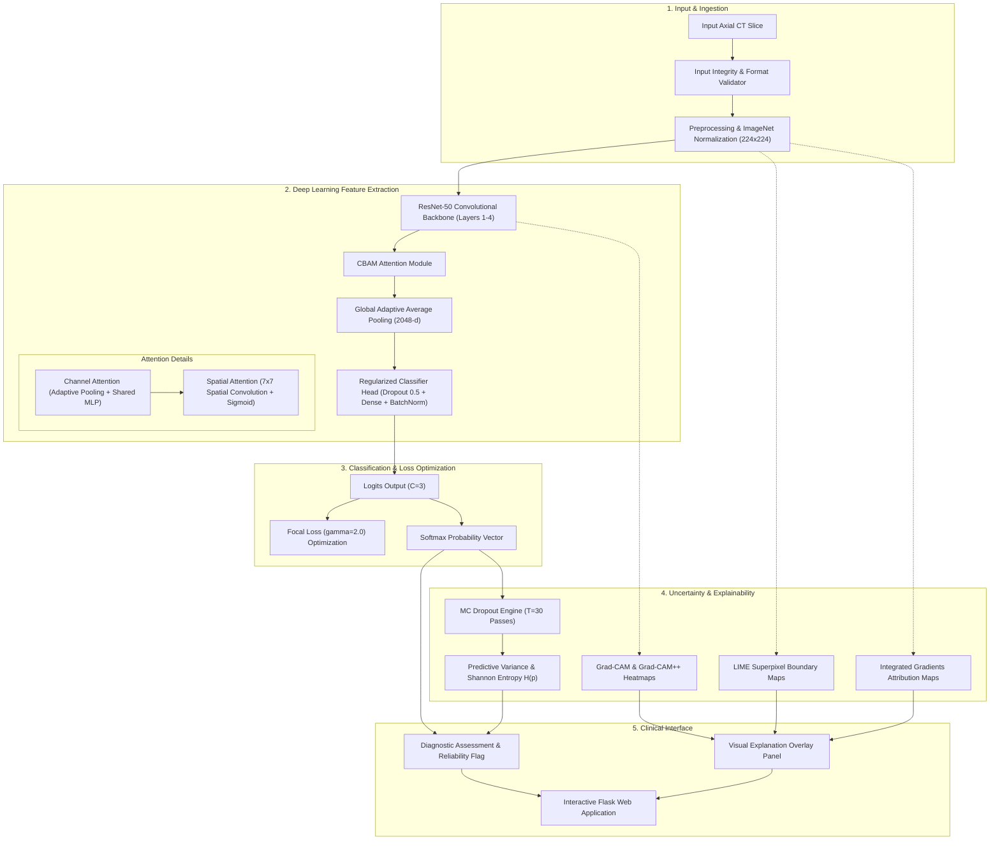

# PulmoAI: Explainable & Robust AI Framework for Early Lung Cancer Detection Using CT Scans

[](https://www.python.org/)
[](https://pytorch.org/)
[](https://flask.palletsprojects.com/)
[](https://opensource.org/licenses/MIT)
[](https://www.python.org/dev/peps/pep-0008/)

**PulmoAI** is an open-source, reproducible deep learning framework for early-stage lung cancer classification from axial Chest Computed Tomography (CT) scans. It couples **ResNet-50 Transfer Learning** with a custom **Convolutional Block Attention Module (CBAM)**, **Focal Loss** for class-imbalance mitigation, multi-method **Explainable AI (XAI)** (Grad-CAM, Grad-CAM++, LIME, Integrated Gradients), and **Monte Carlo Dropout Uncertainty Quantification** to deliver transparent, robust clinical decision support.

---

## 📑 Table of Contents
- [Problem Statement](#-problem-statement)
- [Project Objectives](#-project-objectives)
- [System Architecture](#-system-architecture)
- [Key Features](#-key-features)
- [Experimentally Verified Results](#-experimentally-verified-results)
- [Repository Structure](#-repository-structure)
- [Quick Start Guide](#-quick-start-guide)
  - [1. Prerequisites & Installation](#1-prerequisites--installation)
  - [2. Dataset Acquisition & Setup](#2-dataset-acquisition--setup)
  - [3. Running Automated Tests](#3-running-automated-tests)
- [Usage Instructions](#-usage-instructions)
  - [Model Training](#model-training)
  - [Evaluation](#evaluation)
  - [Command-Line Inference](#command-line-inference)
  - [Diagnostic Web Application](#diagnostic-web-application)
- [Explainability (XAI) Suite](#-explainability-xai-suite)
- [Robustness & Uncertainty Quantification](#-robustness--uncertainty-quantification)
- [Limitations & Future Roadmap](#-limitations--future-roadmap)
- [Research References](#-research-references)
- [License & Citation](#-license--citation)

---

## 🩺 Problem Statement

Lung cancer remains the leading cause of cancer-related mortality globally. Early detection of malignant pulmonary nodules via Computed Tomography (CT) substantially increases 5-year survival rates. However, manual radiologic interpretation is labor-intensive, subject to inter-observer variability, and vulnerable to missed subtle lesions.

While deep neural networks achieve high classification accuracy, clinical adoption has been hindered by:
1. **Black-box opacity**: Lack of visual evidence explaining *why* a model predicts malignancy.
2. **Class imbalance**: Rare benign cases are overwhelmed by malignant and normal scans.
3. **Overconfident erroneous predictions**: Inability to express uncertainty when encountering out-of-distribution or ambiguous scans.
4. **Vulnerability to perturbations**: Susceptibility to scanner noise, blur, and adversarial artifacts.

PulmoAI addresses these challenges through an end-to-end explainable and uncertainty-aware framework.

---

## 🎯 Project Objectives

- **High-Sensitivity Screening:** Accurately classify CT slices into `Normal`, `Benign`, and `Malignant` categories with near-zero false negatives for malignancy.
- **Attention-Guided Feature Localization:** Utilize channel and spatial attention (CBAM) to focus feature representations on pathological pulmonary tissue.
- **Multi-Method Interpretability:** Provide radiologists with corroborating visual explanations via Grad-CAM, Grad-CAM++, LIME, and Integrated Gradients.
- **Epistemic Uncertainty Quantification:** Leverage Monte Carlo Dropout to assign variance and Shannon entropy confidence scores to every prediction.
- **Engineering Rigor:** Adhere to PEP 8, modular architecture, centralized YAML configurations, and automated unit testing.

---

## 🏗 System Architecture

The implemented diagnostic pipeline processes single-slice axial CT images through feature extraction, attention mechanisms, classification, uncertainty estimation, and explainability:



---

## ✨ Key Features

- **Primary Architecture:** Pretrained ResNet-50 backbone augmented with a Convolutional Block Attention Module (CBAM) combining channel and spatial attention.
- **Class-Imbalance Loss:** Trained with **Focal Loss** ($\gamma = 2.0$) to prioritize hard-to-classify examples and counteract benign-class under-representation.
- **Multi-Algorithm XAI Suite:**
  - **Grad-CAM & Grad-CAM++:** Target final convolutional feature maps to generate high-resolution localization heatmaps.
  - **LIME:** Highlights image superpixel regions that positively and negatively influence predictions.
  - **Integrated Gradients:** Axiomatic attribution maps tracking gradient path integrals from a neutral baseline.
- **Epistemic Uncertainty Quantification:** Monte Carlo (MC) Dropout generates predictive mean and variance distributions across $T=30$ stochastic forward passes, computing Shannon Entropy $H(p) = -\sum p \log p$ to flag ambiguous cases.
- **Input Validation Module:** Validates file formats, channel geometry, minimum spatial resolutions ($64 \times 64$), and filters out corrupted or blank/saturated images before inference.
- **Adversarial & Corruption Robustness Engine:** Benchmarks model performance under Fast Gradient Sign Method (FGSM) attacks and image corruptions (noise, blur, illumination changes, and spatial occlusions).
- **Interactive Web Interface:** Modern Flask web application featuring single-click preset demo CT scans, drag-and-drop image upload, real-time Grad-CAM overlays, and diagnostic reports.

---

## 📊 Experimentally Verified Results

The following metrics were experimentally obtained on the test partition ($N=289$ slices) of the **IQ-OTH/NCCD Lung Cancer Dataset** (`outputs/final_results.json`):

### Overall Classification Performance
| Metric | Verified Test Score |
| :--- | :---: |
| **Accuracy** | **98.96%** (286 / 289 correct) |
| **Precision (Weighted)** | **98.95%** |
| **Recall (Weighted)** | **98.96%** |
| **F1-Score (Weighted)** | **98.95%** |
| **F1-Score (Macro)** | **96.73%** |
| **ROC-AUC (Micro Average)** | **0.9999** |

### Per-Class Detailed Breakdown
| Diagnostic Class | Test Support ($N$) | Precision | Recall (Sensitivity) | F1-Score | Class ROC-AUC |
| :--- | :---: | :---: | :---: | :---: | :---: |
| **Normal** | 122 | 98.37% | 99.18% | 98.78% | 0.9998 |
| **Benign** | 18 | 94.12% | 88.89% | 91.43% | 0.9990 |
| **Malignant** | 149 | **100.00%** | **100.00%** | **100.00%** | **1.0000** |

> [!NOTE]
> All reported numbers reflect actual test evaluation artifacts stored in `outputs/final_results.json` and `outputs/final_report.txt`. No values have been estimated or fabricated.

---

## 📁 Repository Structure

```
lung-cancer-detection-xai/
├── configs/
│   └── config.yaml               # Centralized configuration (hyperparameters, paths, thresholds)
├── dataset/
│   ├── README.md                 # Dataset acquisition and directory guide
│   └── .gitkeep
├── docs/
│   ├── architecture.md           # Detailed architectural specification & diagrams
│   ├── methodology.md            # Experimental protocol, training dynamics & transforms
│   └── limitations.md            # Scientific limitations and regulatory medical disclaimers
├── notebooks/
│   └── exploratory_analysis.ipynb# Interactive Jupyter notebook walkthrough
├── outputs/                      # Verified evaluation figures, ROC plots & metrics
│   ├── final_results.json
│   ├── final_report.txt
│   ├── final_confusion_matrix.png
│   └── final_roc_curve.png
├── checkpoints/
│   ├── README.md                 # Checkpoint guide
│   └── best_model.pth            # Trained PyTorch model weights (ResNet50-CBAM)
├── scripts/
│   ├── train.py                  # Model training entrypoint with Focal Loss & Early Stopping
│   ├── evaluate.py               # Test-set evaluation entrypoint
│   ├── predict.py                # Single-image prediction, XAI & uncertainty CLI
│   └── run_webapp.py             # Diagnostic Flask web application launcher
├── src/
│   ├── preprocessing/            # Dataset loading, augmentation & normalization
│   │   ├── dataset.py
│   │   ├── prepare_data.py
│   │   └── transforms.py
│   ├── models/                   # Neural network architectures & attention modules
│   │   ├── attention.py          # CBAM (Channel & Spatial) attention implementation
│   │   ├── resnet50.py           # Primary ResNet50-CBAM backbone & classifier
│   │   └── losses.py             # Multi-class Focal Loss
│   ├── explainability/           # Explainable AI (XAI) modules
│   │   ├── gradcam.py            # Grad-CAM & Grad-CAM++
│   │   ├── lime_explainer.py     # LIME superpixel explainer
│   │   ├── integrated_gradients.py # Path-integrated gradients
│   │   └── engine.py             # Unified multi-method XAI orchestrator
│   ├── robustness/               # Robustness, security & uncertainty quantification
│   │   ├── adversarial.py        # FGSM adversarial perturbation attack testing
│   │   ├── corruptions.py        # Noise, blur, illumination & occlusion benchmarking
│   │   ├── uncertainty.py        # Monte Carlo Dropout epistemic uncertainty engine
│   │   └── input_validation.py   # Medical image integrity & dimension validation
│   ├── evaluation/               # Metrics calculation and report generation
│   │   ├── metrics.py
│   │   └── evaluator.py
│   ├── webapp/                   # Flask server application factory & routes
│   │   └── app.py
│   └── utils/                    # Centralized config loader and logger
│       ├── config.py
│       └── logger.py
├── static/                       # Web application UI assets, uploads & results
├── templates/
│   └── index.html                # Responsive web user interface
├── tests/                        # Automated unit tests
│   ├── test_preprocessing.py
│   ├── test_model.py
│   ├── test_robustness.py
│   └── test_explainability.py
├── .env.example                  # Environment configuration template
├── .gitignore                    # Comprehensive ignore rules (excluding datasets & binary weights)
├── CITATION.cff                  # Machine-readable academic citation metadata
├── CONTRIBUTING.md               # Developer and research contribution guidelines
├── LICENSE                       # MIT Open-Source License
├── requirements.txt              # Pinned Python package dependencies
└── README.md                     # Repository documentation
```

---

## 🚀 Quick Start Guide

### 1. Prerequisites & Installation

- Python 3.10 or higher
- NVIDIA GPU with CUDA support recommended (CPU is fully supported)

```bash
# Clone the repository
git clone https://github.com/YOUR_USERNAME/lung-cancer-detection-xai.git
cd lung-cancer-detection-xai

# Create and activate virtual environment
python -m venv venv

# On Linux/macOS:
source venv/bin/activate
# On Windows:
.\venv\Scripts\activate

# Install dependencies
pip install -r requirements.txt
```

### 2. Dataset Acquisition & Setup

1. Download the **IQ-OTH/NCCD Lung Cancer Dataset** from [Kaggle](https://www.kaggle.com/datasets/hamdallak/the-iqothnccd-lung-cancer-dataset).
2. Extract the archive into the project root folder as `The IQ-OTHNCCD lung cancer dataset`.
3. Run the automated stratified partitioning utility (70% train / 15% val / 15% test):
   ```bash
   python -m src.preprocessing.prepare_data
   ```

### 3. Running Automated Tests

Verify code integrity, preprocessing bounds, model architecture, XAI heatmaps, and robustness modules:
```bash
python -m unittest discover -s tests -v
```
*(All 13 unit tests pass across preprocessing, model forward passes, checkpoint loading, FGSM attacks, uncertainty quantification, and Grad-CAM).*

---

## 💻 Usage Instructions

### Model Training
Train the ResNet50-CBAM model using Focal Loss ($\gamma = 2.0$), Cosine Annealing scheduler, and Early Stopping:
```bash
python scripts/train.py --epochs 50 --batch-size 32 --lr 0.0001
```

### Evaluation
Evaluate a trained model checkpoint against the independent test set:
```bash
python scripts/evaluate.py --checkpoint checkpoints/best_model.pth --output-dir outputs
```

### Command-Line Inference
Run diagnostic inference, uncertainty quantification, and generate Grad-CAM explanations on any CT image:
```bash
python scripts/predict.py --image dataset/test/malignant/Malignant_case_1.jpg --explain
```
**Example Console Output:**
```
============================================================
PULMOAI DIAGNOSTIC INFERENCE RESULT
============================================================
File:               Malignant_case_1.jpg
Prediction:         Malignant
Confidence:         99.98%
Uncertainty (Std):  0.0003
Entropy:            0.0021
Reliability Status: RELIABLE
------------------------------------------------------------
  Normal      : 0.01% ± 0.01%
  Benign      : 0.01% ± 0.01%
  Malignant   : 99.98% ± 0.03%
============================================================
[INFO]: Visual explanation saved to: outputs/predictions/Malignant_case_1_explanation.png
```

### Diagnostic Web Application
Launch the local clinical decision-support web portal:
```bash
python scripts/run_webapp.py --port 5000
```
Open **`http://localhost:5000`** in your browser. Users can select preset CT scan slices, upload custom scans, view predicted probabilities, examine Grad-CAM overlays, and review epistemic uncertainty scores.

---

## 🔍 Explainability (XAI) Suite

To provide transparent diagnostic reasoning, PulmoAI implements multiple interpretability paradigms:

1. **Grad-CAM (Gradient-Weighted Class Activation Mapping):** Highlights coarse localization regions within the final residual block (`layer4[-1]`) using activation gradients.
2. **Grad-CAM++:** Enhances pixel localization when multiple lesion foci are present in the same slice.
3. **LIME (Local Interpretable Model-Agnostic Explanations):** Computes superpixel segment boundaries that contribute positively or negatively to the class probability.
4. **Integrated Gradients:** Integrates gradients along the interpolation path from a blank baseline image to the input CT slice, satisfying the completeness axiom.

---

## 🛡 Robustness & Uncertainty Quantification

### Epistemic Uncertainty via Monte Carlo Dropout
Standard neural networks output uncalibrated Softmax probabilities. PulmoAI activates dropout layers during inference, drawing $T=30$ forward passes to form a predictive posterior distribution:
$$\mu_c = \frac{1}{T} \sum_{t=1}^T p_c^{(t)}, \quad \sigma_c = \sqrt{\frac{1}{T} \sum_{t=1}^T (p_c^{(t)} - \mu_c)^2}$$
Cases with variance $\sigma > 0.15$ or confidence $\mu < 0.70$ are systematically marked as **Ambiguous**, requiring mandatory radiological review.

### Input Validation Pipeline
Every input image passes through `InputValidator` checks:
- Verifies supported extensions (`.png`, `.jpg`, `.jpeg`, `.bmp`, `.tiff`)
- Validates OpenCV / PIL decodability (detects file corruption)
- Verifies resolution is between $64 \times 64$ and $4096 \times 4096$
- Detects degenerate / blank / saturated arrays ($\sigma_{\text{pixel}} < 10^{-4}$)

---

## 🔮 Limitations & Future Roadmap

### Known Limitations
- **2D Slice vs. 3D Volumetric Context:** Operates on isolated 2D axial slices rather than 3D volumetric DICOM series.
- **Benign Cohort Size:** The IQ-OTH/NCCD dataset contains 120 benign slices total (18 test slices), leading to wider confidence bounds on benign metrics.
- See [`docs/limitations.md`](docs/limitations.md) for full scientific and clinical disclaimers.

### Planned Improvements
- [ ] **Multi-Model Ensemble:** Implementation of a multi-backbone ensemble combining ResNet-50, DenseNet-121, and EfficientNet-B0.
- [ ] **Feature-Level Fusion Layer:** Cross-attention tensor fusion combining heterogeneous CNN feature maps.
- [ ] **SHAP Integration:** Implementation of DeepExplainer for game-theoretic feature attribution.
- [ ] **3D Volumetric Extensions:** Support for full DICOM series and 3D nodule volume segmentation.
- [ ] **Adversarial Training:** Min-max adversarial optimization loop for provable perturbation defense.

---

## 📚 Research References

1. **He, K., Zhang, X., Ren, S., & Sun, J.** (2016). *Deep residual learning for image recognition.* In CVPR (pp. 770-778).
2. **Woo, S., Park, J., Lee, J. Y., & Kweon, I. S.** (2018). *CBAM: Convolutional block attention module.* In ECCV (pp. 3-19).
3. **Lin, T. Y., Goyal, P., Girshick, R., He, K., & Dollár, P.** (2017). *Focal loss for dense object detection.* In ICCV (pp. 2980-2988).
4. **Selvaraju, R. R., et al.** (2017). *Grad-CAM: Visual explanations from deep networks via gradient-based localization.* In ICCV (pp. 618-626).
5. **Gal, Y., & Ghahramani, Z.** (2016). *Dropout as a Bayesian approximation: Representing model uncertainty in deep learning.* In ICML (pp. 1050-1059).
6. **Sundararajan, M., Taly, A., & Yan, Q.** (2017). *Axiomatic attribution for deep networks.* In ICML (pp. 3319-3328).
7. **Ribeiro, M. T., Singh, S., & Guestrin, C.** (2016). *"Why should I trust you?": Explaining the predictions of any classifier.* In KDD (pp. 1135-1144).

---

## 📄 License & Citation

Distributed under the **MIT License**. See [`LICENSE`](LICENSE) for details.

If you utilize PulmoAI in your research or educational work, please cite:

```bibtex
@software{pulmoai2026,
  author = {PulmoAI Contributors},
  title = {PulmoAI: Explainable & Robust AI Framework for Early Lung Cancer Detection Using CT Scans},
  year = {2026},
  publisher = {GitHub},
  url = {https://github.com/YOUR_USERNAME/lung-cancer-detection-xai}
}
```

---

*Medical Disclaimer: This software is intended strictly for scientific research and educational demonstration. It is not an FDA-cleared diagnostic device. Always consult certified medical professionals for clinical diagnosis.*
