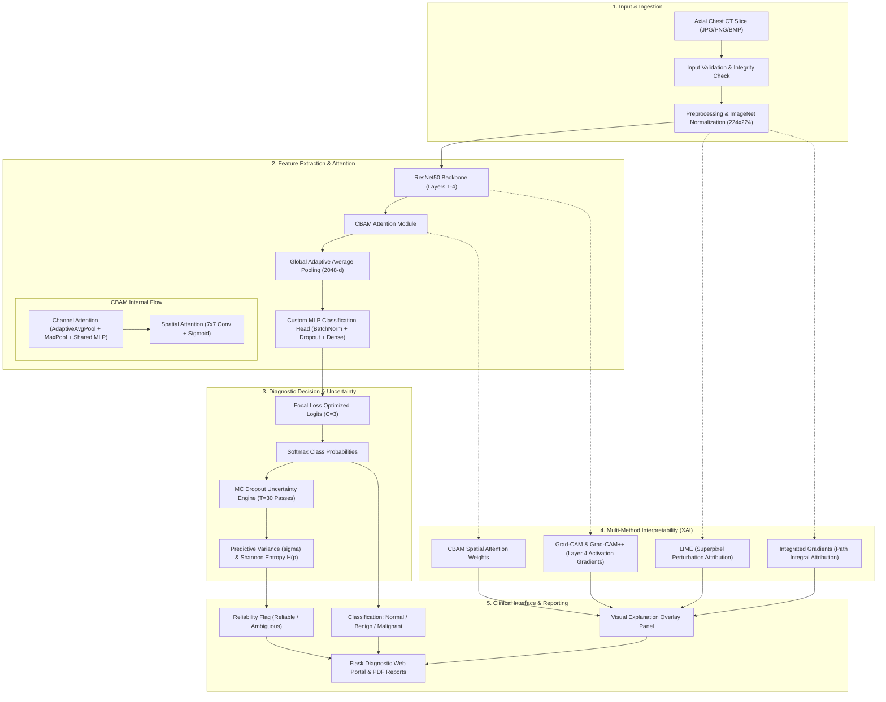

# System Architecture: PulmoAI Framework

## 1. Overview

PulmoAI is a deep learning and Explainable AI (XAI) framework tailored for the automated classification and interpretation of axial chest Computed Tomography (CT) scans for lung cancer detection. The architecture integrates transfer learning, attention-based feature refinement, class-imbalance loss optimization, multi-method interpretability, and epistemic uncertainty quantification.

---

## 2. Core Architectural Components

### 2.1 Pretrained ResNet50 Backbone
- **Role:** Deep convolutional feature extraction from lower-level pulmonary edges to higher-level tissue textures.
- **Weights:** ImageNet-1K (V2) transfer learning weights.
- **Layers:** Conv1, BatchNorm1, ReLU, MaxPool, followed by Residual Stages 1 to 4 (producing 2048-dimensional feature maps at the output of Stage 4).

### 2.2 Convolutional Block Attention Module (CBAM)
The CBAM module refines feature representations sequentially:
1. **Channel Attention:** Identifies *which* feature maps contain critical diagnostic signals. Combines global average pooling and global max pooling through a shared 2-layer MLP with reduction ratio $r = 16$.
   $$\mathbf{M}_c(\mathbf{F}) = \sigma\left(W_1(W_0(\mathbf{F}_{avg}^c)) + W_1(W_0(\mathbf{F}_{max}^c))\right)$$
2. **Spatial Attention:** Identifies *where* suspicious nodular or lesion tissue is situated across the 2D spatial grid. Operates along the channel axis using average and max pooling combined with a $7 \times 7$ convolution:
   $$\mathbf{M}_s(\mathbf{F}) = \sigma\left(f^{7 \times 7}\left([\mathbf{F}_{avg}^s; \mathbf{F}_{max}^s]\right)\right)$$

### 2.3 Regularized Classification Head
The original ResNet50 1000-way linear layer is replaced with a custom regularized multi-stage MLP:
$$\text{Input (2048)} \to \text{Dropout}(0.5) \to \text{Dense}(512) \to \text{BatchNorm1d} \to \text{ReLU} \to \text{Dropout}(0.25) \to \text{Dense}(128) \to \text{BatchNorm1d} \to \text{ReLU} \to \text{Dense}(3)$$

### 2.4 Focal Loss Formulation
To mitigate significant class imbalance (e.g. fewer benign cases relative to malignant and normal cases), Focal Loss dynamically down-weights easy non-cancerous examples:
$$\text{FL}(p_t) = -\alpha_t (1 - p_t)^\gamma \log(p_t)$$
with focusing exponent $\gamma = 2.0$.

---

## 3. Explainability and Robustness Integration

1. **Grad-CAM & Grad-CAM++:** Target the final convolutional stage of ResNet50 (`backbone.layer4[-1]`), generating localization maps that highlight discriminative image regions driving the nodule classification.
2. **Integrated Gradients:** Computes path integrals of gradients along a linear interpolation between a black baseline image and the input CT slice, fulfilling axiomatic completeness and implementation invariance.
3. **LIME:** Explains individual slice predictions by training a local interpretable surrogate model over perturbed superpixel segments.
4. **Monte Carlo Dropout Uncertainty:** By retaining stochastic dropout during inference across $T=30$ forward passes, the framework approximates Bayesian inference, deriving predictive variance and Shannon entropy to safely flag ambiguous cases for second-opinion review.

---

## 4. Planned Architectural Roadmap

The following components are proposed research expansions:
- **Multi-Backbone Ensemble:** Integration of DenseNet121 (dense feature reuse) and EfficientNetB0 (compound scaling efficiency).
- **Deep Fusion Layer:** Feature concatenation or attention-gated tensor fusion across heterogeneous backbones prior to classification.
- **SHAP (SHapley Additive exPlanations):** DeepExplainer integration for game-theoretic feature attribution.
- **Adversarial Training Defense:** Min-max adversarial training incorporating FGSM/PGD perturbations into the optimization loop.
